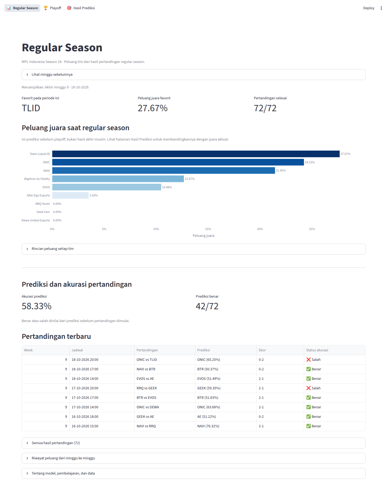
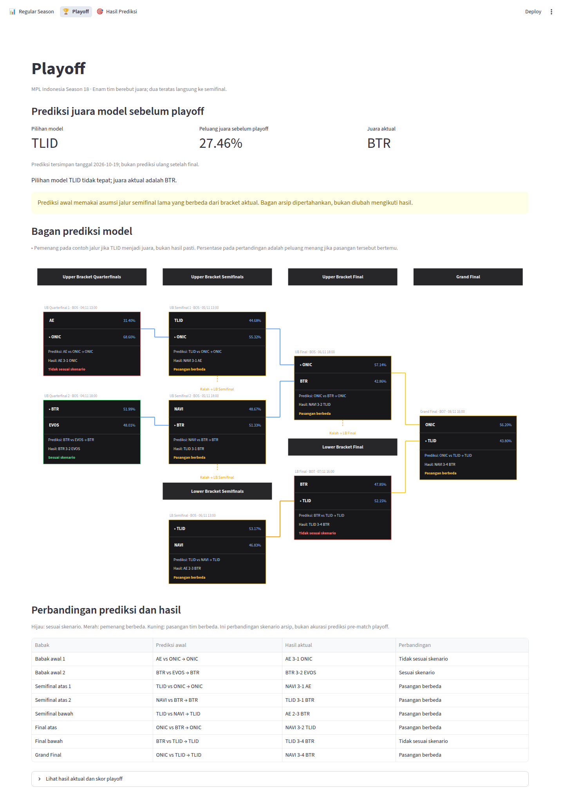
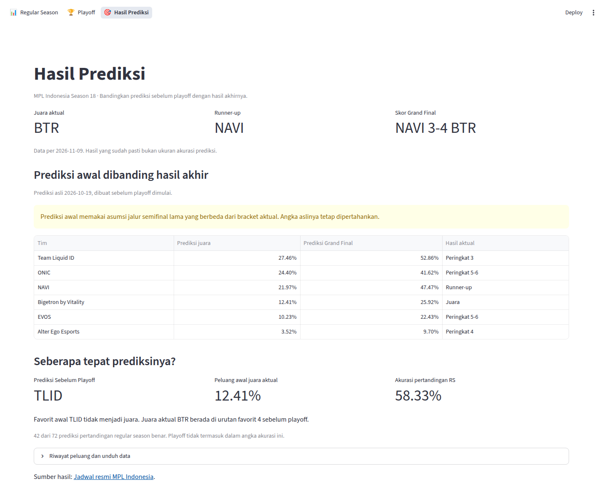

# Prediksi Juara MPL Indonesia

Dashboard untuk melihat peluang juara MPL Indonesia dan membandingkan prediksi dengan
hasil pertandingan sebenarnya. Proyek ini berfokus pada Season 18, dengan memanfaatkan
data musim sebelumnya dan perkembangan performa tim sepanjang kompetisi.

## Fitur utama

- **Regular Season:** peluang juara, jadwal, hasil pertandingan terbaru, dan status
  prediksi benar atau salah. Riwayat prediksi mingguan juga tersedia.
- **Playoff:** bagan enam tim yang menampilkan prediksi awal, skor aktual, dan
  perbandingan hasil pada setiap pertandingan.
- **Hasil Prediksi:** ringkasan pilihan model, peluang juara sebelum playoff, hasil akhir,
  serta unduhan data perbandingan.

## Tampilan aplikasi

Screenshot diambil langsung dari dashboard. Klik gambar untuk melihat ukuran penuh.

| Regular Season | Playoff | Hasil Prediksi |
| :---: | :---: | :---: |
| [](assets/screenshots/regular-season.png) | [](assets/screenshots/playoff.png) | [](assets/screenshots/hasil-prediksi.png) |

## Cara kerja singkat

Sistem mempelajari hasil pertandingan sebelumnya untuk memperkirakan kekuatan tim,
kemudian menyimulasikan jalannya kompetisi untuk menghitung peluang juara.
Model utamanya menggunakan **Logistic Regression**, sedangkan **Random Forest** dan
**XGBoost** digunakan sebagai pembanding.

Data historis mencakup Season 1-17. Pelatihan utama memakai Season 4-17 agar sesuai
dengan era franchise MPL Indonesia.

Prediksi adalah perkiraan, bukan jaminan kemenangan. Prediksi lama tetap disimpan
dan dibedakan dari hasil aktual. Jika pasangan tim berubah dari skenario awal,
perbandingannya ditandai sebagai **Pasangan berbeda**, bukan dipaksakan benar atau salah.

## Menjalankan dashboard

Gunakan Python 3.12 atau lebih baru. Dari folder proyek, jalankan:

```bash
python3 -m venv .venv
source .venv/bin/activate
python -m pip install -r requirements.txt
python -m streamlit run streamlit_app.py
```

Buka alamat lokal yang muncul di terminal. Data prediksi yang sudah tersedia dapat
langsung dilihat tanpa melatih ulang model.
